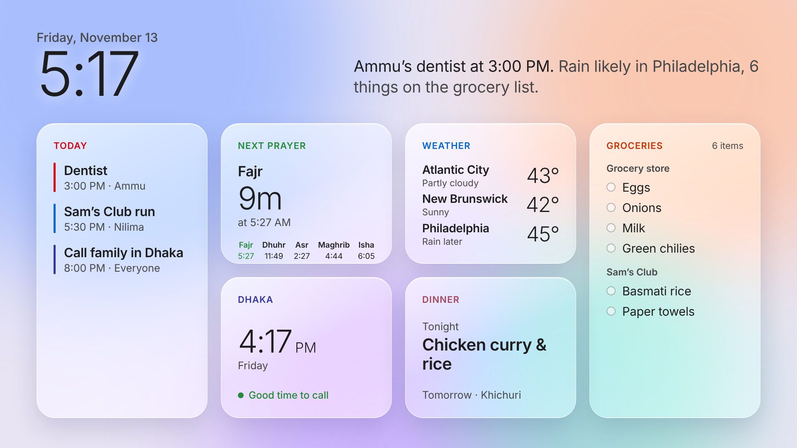
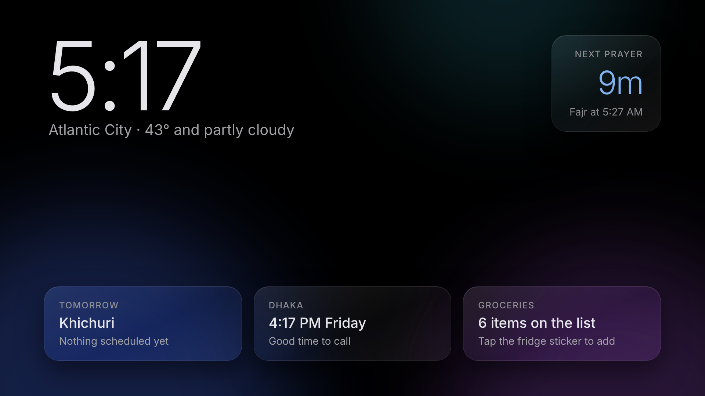
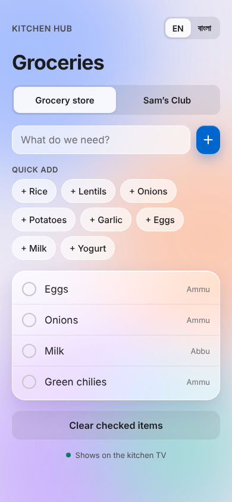
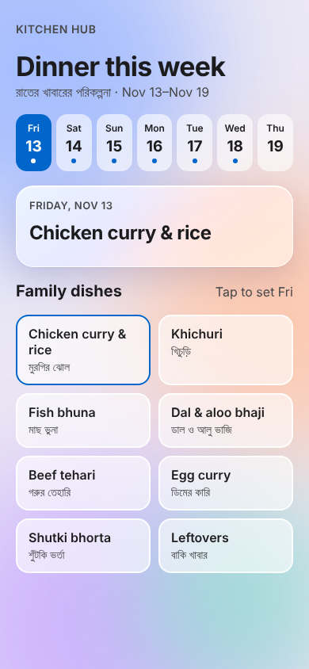
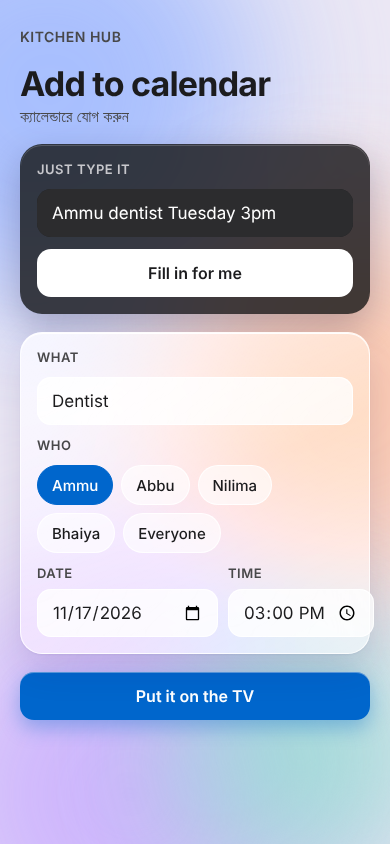

# Kitchen Hub

A family dashboard for a wall-mounted TV in the kitchen. It shows what the household needs at a glance, like today's appointments, the grocery list, the week's dinners, prayer times, weather in the cities where family lives, and the time in Dhaka. Anyone can add to it by tapping their phone on a sticker on the fridge.

**[Live demo](https://nilima04.github.io/kitchen-hub/)** · Phone pages: [Groceries](https://nilima04.github.io/kitchen-hub/add/groceries.html) · [Dinner](https://nilima04.github.io/kitchen-hub/add/dinner.html) · [Calendar](https://nilima04.github.io/kitchen-hub/add/calendar.html)



## Why I built it

My family was running the house off a paper calendar on the fridge and group texts. Appointments got missed, and the grocery list lived in whoever's head remembered it. We also have relatives in Dhaka, 11 hours ahead, so "can we call now?" is a daily question. We had a spare 55" Android TV, so I wanted to turn it into one shared screen the whole family actually uses.

The hard requirement was that it be easy for everyone, including my parents. Nobody installs an app or makes an account. You tap your phone on the fridge and type.

## What it does

**On the TV**
- **Today:** the day's appointments and events, color-coded, with who each one is for.
- **Daily summary:** a short sentence at the top covering the next event, rain, and what's on the grocery list.
- **Next prayer:** a live countdown plus all five daily prayer times for Atlantic City. On Fridays, Dhuhr is labeled Jumu'ah.
- **Weather:** live conditions for Atlantic City, New Brunswick and Philadelphia.
- **Family clock:** the time in Dhaka, with a "good time to call" indicator based on waking hours there.
- **Groceries:** the open list, grouped by store (grocery store and Sam's Club).
- **Dinner:** tonight's and tomorrow's dinner from the weekly plan.
- **Night mode:** after 9 PM the screen switches to a dim, mostly black layout with the time, the countdown to Fajr, and tomorrow at a glance. This keeps the kitchen dark and protects the panel from burn-in.



**On your phone** (opened by tapping an NFC sticker or scanning its QR code)

| Groceries | Dinner plan | Add to calendar |
| --- | --- | --- |
|  |  |  |
| Add items to either store, use quick-add buttons, and check things off. The whole page switches between English and Bangla. | Pick a family dish for each day of the week. One tap adds the ingredients it usually needs to the grocery list. | Type something like "Ammu dentist Tuesday 3pm" and the form fills itself in. |

## Product decisions

- **Phones instead of a touchscreen.** A TV across the kitchen isn't something you touch. Everyone already carries a phone, and an NFC sticker opens the right page in one tap without an app. iPhones and Android phones both read NFC tags natively, and a QR code covers any phone that doesn't.
- **No accounts.** The people most likely to quit over a login screen are the ones the hub is most for. Each sticker just opens a web page.
- **Bangla and English.** The family is bilingual, so the phone pages switch languages with one tap, and dishes carry both names.
- **Readable from across the room.** Text is sized for a 55" screen viewed from the counter, there's one widget per question ("what's today?", "when's the next prayer?"), and color only marks the widget headings.
- **Built for a cheap TV.** Android TV browsers vary, so the glass effect falls back to solid cards when blur isn't supported, and the layout scales to any resolution from a single 1920×1080 design.

## How I'll measure success

The hub only works if the family actually uses it instead of the paper calendar and group texts. Once it's running in our kitchen, I'll track:

| Goal | Metric | Target |
| --- | --- | --- |
| Everyone adopts it | Family members who add something in a typical week | All 4 within the first month |
| It replaces the old system | Paper calendar entries vs. hub entries | Paper calendar retired by week 4 |
| Fewer missed appointments | Appointments missed or remembered last-minute | Down from the current baseline |
| Fewer duplicate or forgotten purchases | Grocery runs that miss an item or double-buy | Fewer than 1 a week |
| Adding is effortless | Time from tapping the sticker to an item saved | Under 10 seconds |

These are targets, not results yet. I'll update this section with real numbers after the first month.

## How it works

```
 Fridge stickers (NFC / QR)          Kitchen TV (Android TV + Fully Kiosk Browser)
          │                                       │
          ▼                                       ▼
  add/groceries.html                         index.html
  add/dinner.html      ──►  js/store.js  ◄──  js/tv.js ──► Open-Meteo (weather)
  add/calendar.html         (shared data)            └──► Aladhan (prayer times)
```

- It's a **plain HTML, CSS and JavaScript** static site with no framework or build step, so it runs on GitHub Pages and on low-powered TV hardware.
- `js/store.js` is the only module that touches data. Every page reads and writes through it, so swapping local storage for a real-time database changes one file.
- **Weather** comes from [Open-Meteo](https://open-meteo.com/) (free, no API key) and refreshes every 15 minutes.
- **Prayer times** come from the [Aladhan API](https://aladhan.com/prayer-times-api), are cached per day, and are fetched again after midnight. The calculation method and Asr school are set in `js/config.js`.
- If either API is unreachable, the screen falls back to sample data instead of showing empty widgets.
- The **daily summary** is generated from the day's events, weather and grocery list.
- On the TV, **Fully Kiosk Browser** opens the dashboard full screen at boot and keeps the screen on.

## Project status

This is a working front-end prototype. Being honest about where it stands:

| Area | Status |
| --- | --- |
| TV dashboard (day and night) | Working |
| Live weather and prayer times | Working |
| Phone pages: groceries, dinner, calendar | Working |
| English / Bangla on phone pages | Working |
| Natural-language event entry | Working (rule-based parser) |
| Syncing between phones and the TV | **Next.** Data is currently stored in the browser, so it's shared only between pages on the same device. |
| AI daily summary | **Next.** Currently rule-based; moving to the Claude API. |
| Google Calendar sync | Planned |
| Printable NFC/QR sticker sheet | Designed, not yet exported |

## Roadmap

1. **Real-time sync** through a hosted database (Firebase or Supabase), so an item added on any phone shows on the TV within seconds.
2. **AI summary and event entry** through the Claude API, replacing the rule-based versions.
3. **Shared Google Calendar** as the source of truth for appointments, so events also reach everyone's phone calendar.
4. **Pantry and expiry tracking**, birthday countdowns, and an ambient photo slideshow for when nobody's in the kitchen.

## Run it

```bash
git clone https://github.com/nilima04/kitchen-hub.git
cd kitchen-hub
python3 -m http.server 8000
```

- TV view: http://localhost:8000 (add `?mode=night` or `?mode=day` to force a mode)
- Phone pages: http://localhost:8000/add/groceries.html, `/add/dinner.html`, `/add/calendar.html`

To customize the household (cities, family names, stores, dishes, prayer method), edit `js/config.js`.

**Deploy:** enable GitHub Pages on the `main` branch. Then point Fully Kiosk Browser on the TV to the Pages URL, and write each phone page's URL onto an NTAG213/215 NFC sticker using any NFC writer app.

## Project structure

```
index.html          TV dashboard (day + night views)
add/                Phone pages opened from the fridge stickers
css/hub.css         TV styles
css/phone.css       Phone styles
js/config.js        Household settings
js/store.js         Shared data layer
js/tv.js            TV logic: clock, prayer times, weather, summary, rendering
js/groceries.js     Grocery list page
js/dinner.js        Weekly dinner planner
js/calendar.js      Event entry and natural-language parser
docs/               Screenshots
```

## Built with

HTML, CSS, vanilla JavaScript · Open-Meteo API · Aladhan API · Inter and Noto Sans Bengali fonts · Designed and built with help from Claude.
